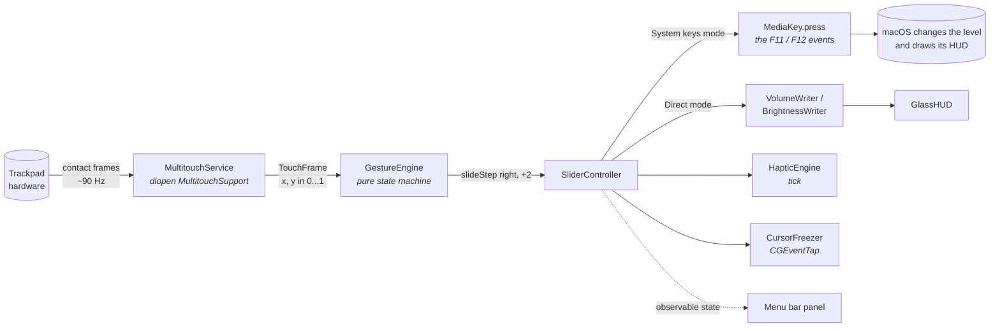
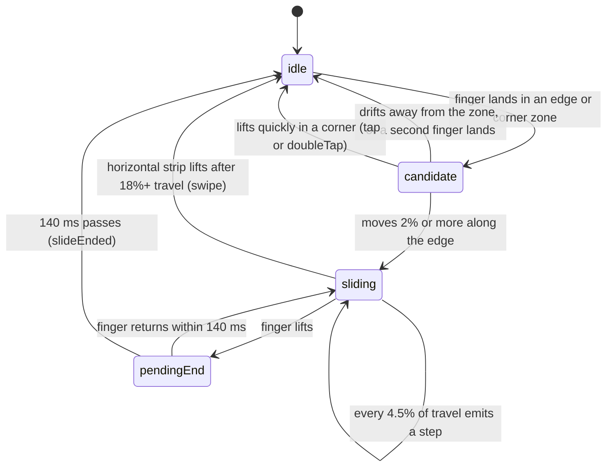

# macSlider

**Your trackpad has four edges. macOS uses none of them. Let's fix that.**

Slide a finger up the right edge: volume goes up. Slide it down the left edge: the screen dims. Flick along the bottom: next song. Double-tap a corner: mute. No keyboard, no menu, no looking. It feels like it should have shipped with the Mac.

macSlider is a free, MIT-licensed menu bar app for macOS 14 and later. On macOS 26 Tahoe it wears Liquid Glass; on 14 and 15 it wears a frosted coat instead.

```
            ┌──────────────────────────────────────────┐
            │ ◉ double-tap: your pick     ◉ Quick Mute │
            │ ░                                      █ │
  brightness│ ░                                      █ │ volume
    lives   │ ░            (your finger              █ │  lives
    here    │ ░             goes here)               █ │  here
            │ ░                                      █ │
            │ ◉        ◂  swipe for media  ▸         ◉ │
            └──────────────────────────────────────────┘
```

## Table of contents

- [Thirty seconds to try it](#thirty-seconds-to-try-it)
- [What it does](#what-it-does)
- [The menu bar panel](#the-menu-bar-panel)
- [Settings](#settings)
- [How a slide becomes a sound](#how-a-slide-becomes-a-sound)
- [The gesture engine, for the curious](#the-gesture-engine-for-the-curious)
- [Two ways to move a level](#two-ways-to-move-a-level)
- [Project map](#project-map)
- [Hacking on it](#hacking-on-it)
- [Known limitations](#known-limitations)
- [FAQ](#faq)
- [Credits and license](#credits-and-license)

## Thirty seconds to try it

Download `macSlider-<version>.zip` from the [latest release](https://github.com/cddharthsingh/macSlider/releases/latest), unzip it, and drag `macSlider.app` to `/Applications`.

> **This build is ad-hoc signed, not notarized.** macOS will block it on first launch with *"macSlider" Not Opened* or *cannot be opened because the developer cannot be verified*. That is Gatekeeper doing its job on an app without an Apple Developer signature, not a sign the app is broken. There is no cost to the workaround below, but you do have to do it once.

### Opening it the first time

**macOS 15 Sequoia and later** (right-click → Open no longer works here):

1. Double-click `macSlider.app`. macOS shows the block dialog. Click **Done**.
2. Open **System Settings → Privacy & Security**, scroll down to the **Security** section.
3. Next to *"macSlider" was blocked to protect your Mac*, click **Open Anyway**, then confirm with your password or Touch ID.

**macOS 14 Sonoma:** right-click (or Control-click) `macSlider.app` in Finder, choose **Open**, then click **Open** again in the dialog.

**Any version, from Terminal:** clear the quarantine flag and the block never appears:

```bash
xattr -dr com.apple.quarantine /Applications/macSlider.app
```

### Granting Accessibility access

Once it opens, macSlider asks for Accessibility access. It needs this to press the volume and brightness keys and to hold the cursor still while you slide; without it the edges do nothing. If you dismissed the prompt, go to **System Settings → Privacy & Security → Accessibility** and turn on **macSlider**.

If you rebuild the app yourself, each new build has a new ad-hoc signature and macOS forgets the grant. `make run` resets it so you get a fresh prompt; otherwise remove macSlider from the Accessibility list and re-add it.

Then slide the right edge and listen.

### Uninstalling

Quit macSlider from its panel (the power button or ⌘Q), then drag `macSlider.app` to the Trash. Settings live in `defaults delete dev.macslider.app`, and you can remove the Accessibility entry in **System Settings → Privacy & Security → Accessibility**. If you built from source, `make uninstall` does all of that in one go.

### Build it yourself

You need Xcode 16 or newer. The Command Line Tools alone cannot compile SwiftUI, and `make` will stop and tell you if you're on the wrong toolchain.

```bash
git clone https://github.com/cddharthsingh/macSlider.git
cd macSlider
make run
```

That builds `macSlider.app`, launches it, and opens a three-step guide. Step two asks for Accessibility access. Step three watches you do your first slide and ticks a box when you do. Then slide the right edge and listen.

`make install` copies it to `/Applications`. `make test` runs the gesture tests, which need no trackpad at all.

## What it does

| Gesture | Default action | Switchable to |
|---|---|---|
| Slide the right edge | Volume | Brightness (Swap sides) |
| Slide the left edge | Brightness | Volume (Swap sides) |
| Hold Shift-Option while sliding | Quarter steps | Always on (Precise sliding) |
| Double-tap the top-right corner | Mute / unmute | Off |
| Swipe along the bottom edge | Previous / next track | Reverse direction, or off |
| Double-tap the bottom-right corner | Play / pause (off by default) | Any corner action |
| Slide the top edge | Off | Keyboard backlight, or switch Spaces |
| Double-tap top-left or bottom-left | Nothing | Play/pause, mute, Mission Control, show desktop, lock screen, run a Shortcut |

Plus the things you feel rather than see:

- **Haptics.** A tick under your finger at every step, in three strengths. Mute gives a longer buzz so you can feel it with the lights off.
- **Cursor freeze.** The pointer hides and holds still while you slide, and the tap that started the slide doesn't click whatever was under it.
- **Two fingers means "not mine".** The moment a second finger lands, macSlider steps aside. Scrolling, pinching, and Mission Control swipes are untouched.
- **Bottom quarter only.** Shrink the side edges to the lower part of the pad if your palms keep bumping them.
- **Require Fn or Option.** For people who want a deliberate gesture.
- **Magic Mouse.** Optional. The mouse's top edges become sliders too.
- **Survives sleep.** The trackpad is picked back up after wake or a Bluetooth reconnect.
- **Nothing in the Dock, nothing on the CPU.** The app only wakes when a finger touches the pad.

## The menu bar panel

Click the icon and you get one glass card, not a preferences maze.

```
 ┌──────────────────────────────────────┐
 │ macSlider          Listening    (●)  │
 │                                      │
 │   ┌────────────────────────────┐     │
 │   │▒                          █│     │  a live drawing of your trackpad:
 │   │▒         Volume           █│     │  brightness fills the left edge,
 │   │▒   Brightness · Volume    █│     │  volume fills the right, and your
 │   │▒  ◂ ─ ─ ─ ─ ─ ─ ─ ─ ─ ─ ▸ █│     │  actual fingers show up as dots
 │   └────────────────────────────┘     │
 │                                      │
 │  ☀ 69% Left edge   ♪ 81% Right edge  │
 │                                      │
 │  [ Haptics ] [ Quick Mute ] [ Media ]│  glass chips, tap to toggle
 │                                      │
 │  Sensitivity ───────●───────  1.0×   │
 │  Edge width  ───●───────────  7%     │
 │                                      │
 │  [ Settings ]             [?]  [⏻]   │
 └──────────────────────────────────────┘
```

The panel doubles as a debugger. If a gesture isn't firing, open the panel, touch the pad, and watch where the dot lands relative to the lit zones. Nine times out of ten the answer is "edge width".

## Settings

Press Settings (or Command-comma) and the card slides over to the set-once options.

| Section | Options |
|---|---|
| Edges | Swap sides, bottom quarter only, flip vertical axis, Magic Mouse, required modifier |
| While sliding | Freeze cursor, precise sliding, fine control with Shift-Option, haptic strength, level control mode |
| Media strip | Reverse swipe, double-tap to play or pause |
| Corners & top strip | Top strip action, three assignable corners, Shortcut name |
| App | Appearance (system / light / dark), open at login, Accessibility status |

Everything persists in `UserDefaults` under `dev.macslider.app`. Factory reset: `defaults delete dev.macslider.app`.

## How a slide becomes a sound



Five pieces, no daemon, no kernel extension:

1. **`MultitouchService`** opens Apple's private `MultitouchSupport.framework` with `dlopen` and asks for contact frames. Each frame lists every finger with a normalized position (0 to 1, origin bottom-left). Nothing links against the framework, so the project builds with a stock SDK. If Apple renames a symbol, `isAvailable` turns false and the app says "No trackpad found" instead of crashing.
2. **`GestureEngine`** has no system imports at all. Frames in, events out: `slideBegan`, `slideStep`, `slideEnded`, `swipe`, `tap`, `doubleTap`. Because it is pure, every rule in it has a test that runs on a CI box with no trackpad.
3. **`SliderController`** reads `Settings` and turns events into actions. Everything runs on the main actor so the engine's state machine never races with its timers.
4. **`CursorFreezer`** owns a `CGEventTap`. While a slide is live it swallows pointer motion and clicks, then hands them back. This tap is the reason the app needs Accessibility permission.
5. **`HapticEngine`** uses the private `MTActuator` calls for adjustable strength and falls back to `NSHapticFeedbackManager` if they're missing.

## The gesture engine, for the curious

One finger, one state machine. Here it is:



A few rules worth knowing because they explain the feel:

- **Where you land is where you are.** A finger that starts in the middle of the pad never becomes a slide, however far it travels afterwards. Only the first contact point decides the zone.
- **Corners defer to edges.** Land in the bottom-right corner and slide upward, and the corner candidate hands you over to the right edge. A low start still controls volume.
- **Steps are quantized travel, not velocity.** Sensitivity changes how many millimetres make one step. A slow, careful slide and a quick flick over the same distance produce the same number of steps, which makes the haptic ticks line up with what you hear.
- **A lost contact is not a lift.** Trackpads drop a frame now and then. The engine waits 140 ms before believing you're gone, so the slide continues instead of restarting.

## Two ways to move a level

macSlider deliberately ships two backends. Pick in Settings, While sliding, Level control.

| | System keys (default) | Direct |
|---|---|---|
| How | Posts the same system-defined key events the keyboard sends | Writes to CoreAudio and `DisplayServicesSetBrightness` |
| HUD | The one macOS already draws | macSlider's own Liquid Glass HUD |
| Resolution | 16 steps, 64 with fine control | Continuous (1/64 per step, animated) |
| Can it break? | Only if Apple removes media keys | If either private call changes |
| Extra private API | None | `DisplayServices` |

System keys is the conservative choice: macOS does the work and the Shift-Option quarter-step trick comes free. Direct is for people who want the slider to feel like a slider. The gesture side is identical; only the last step differs.

## Project map

```
Package.swift                           SwiftPM manifest, macOS 14+
Makefile                                app / run / install / test
scripts/build-app.sh                    assembles and ad-hoc signs macSlider.app
Resources/                              Info.plist, entitlements (sandbox off)
Sources/MultitouchBridge/               C header: MultitouchSupport struct layouts
Sources/macSlider/
  App/MacSliderApp.swift                MenuBarExtra, app delegate, onboarding window
  Core/MultitouchService.swift          dlopen, device discovery, wake recovery
  Core/GestureEngine.swift              the state machine above
  Core/Settings.swift                   persisted settings, action enums
  Core/SliderController.swift           gesture to action, live state for the UI
  Actions/SystemActions.swift           media keys, key shortcuts, Shortcuts, level readers
  Actions/DirectLevels.swift            CoreAudio / DisplayServices writers, GlassHUD
  Actions/InputServices.swift           haptics, cursor freeze, modifiers, permissions
  UI/MenuPanelView.swift                the panel
  UI/SettingsPage.swift                 the settings page inside the panel
  UI/OnboardingView.swift               first-run guide
  UI/Components/Glass.swift             Liquid Glass helpers with Material fallbacks
  UI/Components/TrackpadPreview.swift   the live trackpad drawing
Tests/macSliderTests/                   synthetic-frame tests for the gesture engine
```

## Hacking on it

Most feature ideas are "zone + gesture = action", and the code is shaped to make that a three-step change:

1. Add a case to `CornerAction` or `TopStripAction` in `Settings.swift`, with a label and an SF Symbol.
2. Handle it in `SliderController.run(_:)` or `slide(edge:steps:)`. New system calls go in `Actions/`.
3. That's it. The settings page and the trackpad preview enumerate the enums, so the new option appears on its own.

A new *zone* (a middle band, a second strip) means a `Zone` case and its geometry in `GestureEngine.zone(for:)`, an event to emit, and a test in `GestureEngineTests`.

Things we'd love to see:

- Per-app bindings (scrub the timeline in a video player, zoom in a design tool)
- External monitor brightness over DDC
- Pressure as a dimension (press harder to go faster)
- A gesture editor where you draw zones on the preview
- Notarized releases (today's builds are ad-hoc signed)

[CONTRIBUTING.md](CONTRIBUTING.md) has the review checklist. Short version: keep `GestureEngine` free of AppKit, put every private call behind a feature check, and tell us which Mac you tested on.

## Known limitations

- **External monitors don't dim.** Brightness only reaches displays macOS itself can control. DDC support is on the wish list.
- **The very first pixel can click.** Tap-to-click may register before the engine knows a slide has begun. Everything after that is suppressed.
- **Private frameworks are private.** `MultitouchSupport` and `DisplayServices` have been stable for a decade, and a dozen shipping apps rely on them, but treat each new macOS as "probably fine" rather than "guaranteed".
- **Rebuilds can reset the permission.** macOS ties Accessibility access to the signed binary. The build script ad-hoc signs so this happens rarely, but it can happen.

## FAQ

**Why does it need Accessibility access?**
To post the volume and brightness key events and to run the event tap that freezes the cursor. Nothing is logged, stored, or sent anywhere. There is no network code in the repository; grep it.

**Is this the same as EdgeBar / SlideSense / Glisse / Sway?**
Same idea, different code. macSlider is an independent project that borrowed good decisions from the open-source ones (SwiftPM builds, a pure tested recognizer, axis flip) and added its own (two level backends, corner actions, top strip, the live panel). It shares no source with any of them.

**Will it be on the App Store?**
No. The App Sandbox forbids both the private framework and the event tap.

**Does it work with a Magic Trackpad?**
Yes, including after a Bluetooth reconnect. Magic Mouse is opt-in because the mouse's surface is small and most people don't want their mouse muting things.

**My slide goes the wrong way.**
Settings, Edges, Flip vertical axis. Some units report the y axis inverted.

## Credits and license

MIT. See [LICENSE](LICENSE).

The private-framework struct layouts come from years of community reverse engineering shared across many open-source trackpad tools. Thanks to everyone who wrote those down so the rest of us didn't have to.

Apple, Mac, macOS, Magic Trackpad, and Magic Mouse are trademarks of Apple Inc. macSlider is not affiliated with Apple or with EdgeBar.